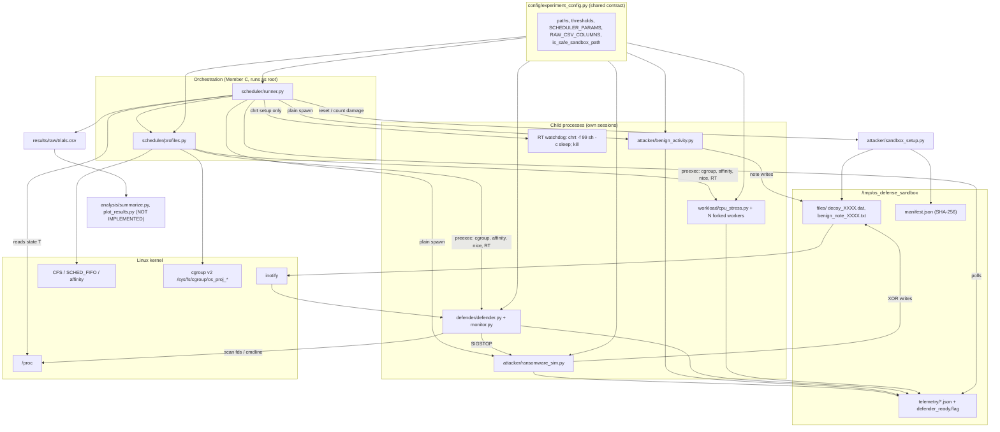
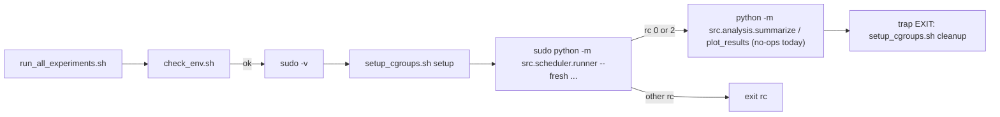
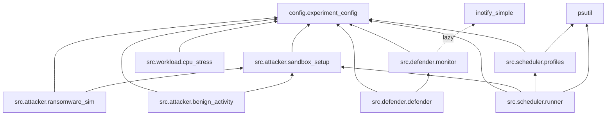

# REPOSITORY MASTER DOCUMENTATION — `linux-scheduler-defender`

> Generated from a complete, file-by-file inspection of the working tree (2026-11-26).
> Nothing in the repository was modified; this is the only file created.
> Upstream: `https://github.com/IsmailNooruddin/linux-scheduler-defender` (branch `main`, cloned at commit `3ee8f77`).

---

## Table of Contents

1. [Project Overview](#1-project-overview)
2. [Technology Stack](#2-technology-stack)
3. [Directory & File Inventory (Inspection Checklist)](#3-directory--file-inventory-inspection-checklist)
4. [Explanation of Every Source File](#4-explanation-of-every-source-file)
5. [Architecture Overview](#5-architecture-overview)
6. [Execution Flow](#6-execution-flow)
7. [Module Dependencies](#7-module-dependencies)
8. [Function & Class Responsibilities](#8-function--class-responsibilities)
9. [Important Algorithms & Data Structures](#9-important-algorithms--data-structures)
10. [Inter-Process Contracts (Telemetry, CSV, Flags)](#10-inter-process-contracts-telemetry-csv-flags)
11. [Build, Test & Execution Instructions](#11-build-test--execution-instructions)
12. [External Dependencies](#12-external-dependencies)
13. [Test Suite Map](#13-test-suite-map)
14. [Existing Results Data (`results/raw/trials.csv`)](#14-existing-results-data-resultsrawtrialscsv)
15. [Known Bugs, Risks & Limitations](#15-known-bugs-risks--limitations)
16. [Unfinished Features](#16-unfinished-features)
17. [Potential Improvements](#17-potential-improvements)
18. [Overall Technical Assessment](#18-overall-technical-assessment)
19. [Guidance for Future Changes (Impact Map)](#19-guidance-for-future-changes-impact-map)

---

## 1. Project Overview

**Title:** *Can Linux Scheduler Controls Keep a Defender Fast Under CPU Load?*
**Context:** Operating Systems term project (Part 4), Section L4. Team: Ismail Nooruddin (A), Hassaan Ul Qadir (B), Munir Tariq (C), Rayyan Alvi (D).

The project is an **OS experiment harness** written in Python. It measures how Linux scheduling controls affect a small file-system "ransomware defender" when a CPU-heavy workload competes for the CPU:

| Control | Kernel mechanism | Setup name |
| :--- | :--- | :--- |
| None (CFS defaults) | — | `default` |
| CFS priority | `setpriority(2)` (`nice -20` defender / `+19` workload) | `nice` |
| Real-time class | `sched_setscheduler(2)` SCHED_FIFO prio 50 (defender) | `chrt` |
| cgroup v2 proportional share | `cpu.weight` 1000 vs 100 | `cgroup_weight` |
| cgroup v2 bandwidth cap | `cpu.max` = 50 % of all cores (workload) | `cgroup_max` |
| CPU affinity | `sched_setaffinity(2)` core 0 vs cores 1..N-1 | `taskset` |
| References | no workload / no defender | `baseline_no_load`, `baseline_workload_solo` |

**Measured metrics per trial:** detection & freeze delay (ms), files damaged before freeze, workload throughput (work units/s → slowdown %), false-alarm rate on benign activity.

**Actors (all separate OS processes):**

- **Attacker** – `ransomware_sim.py`: XOR-scrambles decoy files in a `/tmp` sandbox, 2 ms between files.
- **Benign actor** – `benign_activity.py`: writes 1 harmless note every 0.75 s for 6 s.
- **Defender** – `defender.py` + `monitor.py`: inotify watch → sliding-window burst detector (≥5 distinct files in 500 ms) → `/proc` PID discovery → `SIGSTOP`.
- **Workload** – `cpu_stress.py`: one pure-Python CPU-burning worker per logical core, counts "work units".
- **Runner** – `runner.py` + `profiles.py`: orchestrates trials, applies scheduler controls between `fork()` and `exec()`, verifies them from the kernel, writes `results/raw/trials.csv`.
- **Analysis** – `summarize.py`, `plot_results.py`: **placeholders only (not implemented)**.

Target platform: **Linux / WSL2 (Ubuntu)**. Most runtime code is Linux-only (`/proc`, inotify, `os.sched_*`, cgroup v2, `fork`). Only the pure-logic parts and some attacker tests run on Windows.

---

## 2. Technology Stack

| Category | Item | Where used |
| :--- | :--- | :--- |
| Language | **Python ≥ 3.9** (uses `from __future__ import annotations`, walrus `:=`, `Path \| str` in annotations only) | all `*.py` |
| Language | **Bash** (`set -u`, arrays) | `scripts/*.sh` |
| Markup / config | Markdown, INI (`pytest.ini`), pip requirements, git attributes/ignore | root |
| Data | CSV | `results/raw/trials.csv` |
| Python stdlib (heavy use) | `os`, `signal`, `subprocess`, `multiprocessing` (fork ctx, shared `Array`/`Value`/`Event`), `hashlib`, `json`, `csv`, `argparse`, `pathlib`, `tempfile`, `random`, `shlex`, `dataclasses`, `collections.deque` | everywhere |
| 3rd-party runtime | **psutil ≥ 5.9** | `profiles.py`, `runner.py`, tests |
| 3rd-party runtime | **inotify-simple ≥ 1.3.5** (Linux only, imported lazily) | `monitor.py`, stand-in defender in tests |
| 3rd-party analysis | numpy, pandas, matplotlib | declared in `requirements.txt`, **not imported anywhere yet** |
| Testing | **pytest ≥ 7.4** | `tests/` |
| Linux kernel interfaces | inotify, `/proc/<pid>/{fd,cmdline,comm,stat,cgroup}`, signals (`SIGSTOP`/`SIGCONT`/`SIGKILL`/`SIGTERM`), `sched_setscheduler`, `sched_setaffinity`, `setpriority`, cgroup v2 (`cgroup.controllers`, `cgroup.subtree_control`, `cgroup.procs`, `cpu.weight`, `cpu.max`), `/proc/sys/kernel/sched_rt_runtime_us` | defender, profiles, runner |
| External CLI tools | `chrt` (watchdog), `sh`, `sleep`, `kill`, `nice`/`taskset` (checked only), `sudo`, `stat`, `pgrep`, `nproc` | `profiles.start_watchdog`, scripts |

No compiled code, no C extensions, no build step, no packaging metadata (`setup.py`/`pyproject.toml` absent). Imports rely on running from the repo root (`python -m ...`) or `pytest.ini`'s `pythonpath = .`.

---

## 3. Directory & File Inventory (Inspection Checklist)

**Totals:** 63 files discovered (35 in the working tree + 28 inside `.git/`). All 35 working-tree files inspected. 4 `.git` metadata text files read; the rest of `.git` classified (not read, see below).

### 3.1 Working tree

| # | Path | Size (B) | Type | Inspected | Purpose |
|---|---|---:|---|:---:|---|
| 1 | `.gitattributes` | 120 | config | ✅ | Forces LF endings on `*.sh` (WSL2 bash breaks on CRLF). Verified: `.sh` files are LF; `.py` files are CRLF (harmless). |
| 2 | `.gitignore` | 350 | config | ✅ | Ignores caches, venvs, IDE dirs, `*.tmp`, `*.log`, `/sandbox/`, `results/raw/*.tmp`. |
| 3 | `pytest.ini` | 204 | config | ✅ | `pythonpath = .`, `testpaths = tests`. |
| 4 | `README.md` | 14 658 | docs | ✅ | Project docs, team split, setup, usage, telemetry contract. Results section is a placeholder. |
| 5 | `requirements.txt` | 361 | deps | ✅ | psutil, inotify-simple (linux marker), numpy, pandas, matplotlib, pytest. |
| 6 | `config/__init__.py` | 2 259 | source | ✅ | Re-exports every constant/helper of `experiment_config`. |
| 7 | `config/experiment_config.py` | 14 464 | source | ✅ | **Shared contract**: paths, thresholds, scheduler setups/params, CSV schema, safety helper. |
| 8 | `docs/.gitkeep` | 0 | placeholder | ✅ | Keeps empty `docs/`. |
| 9 | `results/figures/.gitkeep` | 0 | placeholder | ✅ | — |
| 10 | `results/processed/.gitkeep` | 0 | placeholder | ✅ | — |
| 11 | `results/raw/.gitkeep` | 0 | placeholder | ✅ | — |
| 12 | `results/raw/trials.csv` | 11 781 | data (generated) | ✅ (fully aggregated, 195 rows) | Output of one complete benchmark run. See §14. |
| 13 | `scripts/check_env.sh` | 7 300 | script | ✅ | Environment checker (OS, WSL2, /tmp fs, cgroup v2, tools, sudo, cores, RT throttling, Python pkgs, stale processes). |
| 14 | `scripts/setup_cgroups.sh` | 3 937 | script | ✅ | `setup` / `status` / `cleanup` of the two cgroups; self-elevates via sudo. |
| 15 | `scripts/run_all_experiments.sh` | 4 293 | script | ✅ | One-command pipeline: env check → cgroups → runner (sudo) → analysis → cleanup trap. |
| 16 | `src/__init__.py` | 525 | source | ✅ | Package docstring only. |
| 17 | `src/analysis/__init__.py` | 286 | source | ✅ | Docstring only ("To be implemented"). |
| 18 | `src/analysis/plot_results.py` | 353 | source | ✅ | **TODO placeholder – docstring only, no code.** |
| 19 | `src/analysis/summarize.py` | 396 | source | ✅ | **TODO placeholder – docstring only, no code.** |
| 20 | `src/attacker/__init__.py` | 592 | source | ✅ | Docstring; intentionally no submodule imports (avoids `runpy` warnings). |
| 21 | `src/attacker/benign_activity.py` | 11 214 | source | ✅ | Benign note writer for false-alarm trials. |
| 22 | `src/attacker/ransomware_sim.py` | 13 561 | source | ✅ | XOR ransomware simulator. |
| 23 | `src/attacker/sandbox_setup.py` | 15 999 | source | ✅ | Sandbox reset/verify/clean, SHA-256 manifest, damage counter. |
| 24 | `src/defender/__init__.py` | 283 | source | ✅ | Docstring (stale "To be implemented"). |
| 25 | `src/defender/defender.py` | 18 648 | source | ✅ | Defender main: readiness, PID discovery, SIGSTOP, telemetry. |
| 26 | `src/defender/monitor.py` | 10 645 | source | ✅ | `BurstDetector`, `BurstResult`, `SandboxMonitor` (inotify). |
| 27 | `src/scheduler/__init__.py` | 277 | source | ✅ | Docstring. |
| 28 | `src/scheduler/profiles.py` | 31 234 | source | ✅ | Scheduler-control planning/applying/verifying, cgroups, RT watchdog. |
| 29 | `src/scheduler/runner.py` | 36 283 | source | ✅ | Trial orchestration, retries, CSV output, CLI. |
| 30 | `src/workload/__init__.py` | 172 | source | ✅ | Docstring. |
| 31 | `src/workload/cpu_stress.py` | 15 781 | source | ✅ | Multi-process CPU workload + throughput telemetry. |
| 32 | `tests/test_attacker.py` | 13 469 | test | ✅ | 8 tests for Member A code. |
| 33 | `tests/test_defender.py` | 13 126 | test | ✅ | 12 tests (unit + live integration). |
| 34 | `tests/test_scheduler.py` | 19 946 | test | ✅ | 27 tests (profiles + runner with stand-in defender). |
| 35 | `tests/test_workload.py` | 7 638 | test | ✅ | 9 tests (incl. 4 parametrized). |

### 3.2 `.git/` (classified, intentionally not read in full)

| Item | Handling |
|---|---|
| `HEAD`, `config`, `logs/HEAD`, `packed-refs`/refs (listed) | Read/inspected: branch `main`, remote `origin` → GitHub. No credentials stored in `config`. |
| `objects/pack/*.pack/.idx/.rev` (≈120 KB) | Binary git object storage – excluded (history, not working code). |
| `hooks/*.sample` (14 files) | Stock git templates, inactive – excluded. |
| `index`, `description`, `info/exclude`, `logs/refs/**` | Git internal metadata – excluded. |

No `node_modules`, virtual environments, `__pycache__`, binaries, or large datasets exist in the working tree. No secrets, API keys or tokens were found in any file.

---

## 4. Explanation of Every Source File

### 4.1 `config/experiment_config.py` — the shared contract
Single source of truth imported by every module.

- **Paths:** `REPO_ROOT` (resolved from file location), `RESULTS_DIR`, `RAW_RESULTS_DIR`, `PROCESSED_RESULTS_DIR`, `FIGURES_DIR`, `RAW_TRIALS_CSV`.
- **Sandbox:** `SANDBOX_ROOT` = `/tmp/os_defense_sandbox` on POSIX, `%TEMP%\os_defense_sandbox` on Windows; `SANDBOX_FILES_DIR`, `SANDBOX_MANIFEST_PATH`, `TELEMETRY_DIR`, the four `*_TELEMETRY_PATH`s and `DEFENDER_READY_FLAG`.
- **Attack/benign:** 300 decoys × 64 KiB, prefix `decoy_`, ext `.dat`, magic header `OS_DECOY_CLEAN_V1\n`, `XOR_KEY=0xAA`, 2 ms inter-file delay; benign 0.75 s interval for 6 s, prefix `benign_note_`.
- **Defender:** `BURST_EVENT_THRESHOLD=5`, `BURST_WINDOW_MS=500`, `DEFENDER_POLL_TIMEOUT_MS=50`.
- **Workload/safety:** `WORKLOAD_CHUNK_ITERATIONS=50_000`, `TRIAL_TIMEOUT_S=15`, `DEFENDER_READY_TIMEOUT_S=5`.
- **Scheduler:** `TRIALS_PER_SETUP=20`, `SCHEDULER_SETUPS` (8 names), `SCHEDULER_PARAMS` (per-setup dict; `taskset.workload_cores` computed from `os.cpu_count()` **at import time**).
- **CSV schema:** `RAW_CSV_COLUMNS` (11 columns, fixed order).
- `is_safe_sandbox_path(target, sandbox_root)` — safety lock: root must contain a path part `os_defense_sandbox`, must not contain `/mnt/c/` or `OneDrive`, must be under `/tmp/` / system temp (or contain `/tmp/os_defense_sandbox`), and target must equal or be inside root (after `resolve()`).
- `ensure_results_dirs()` — `mkdir -p` the three results dirs.

### 4.2 `config/__init__.py`
Re-exports all of the above with an explicit `__all__`. (Modules actually import from `config.experiment_config` directly.)

### 4.3 `src/attacker/sandbox_setup.py`
- `assert_safe_sandbox(root)` → resolved `Path` or `ValueError("SAFETY LOCK ENGAGED…")`.
- `compute_sha256(path)` — 64 KiB streaming hash.
- `generate_decoy_payload(idx, size)` — header + `FILE_INDEX=NNNN\n` + repeating 48-byte block (`sha256(prefix)+md5(prefix)`), deterministic and unique per file.
- `reset_sandbox(root, count, size)` — validates, `rmtree`s the root, recreates `files/` and `telemetry/`, writes decoys, writes `manifest.json` (`files: {name: sha256}` + metadata).
- `count_damaged_files(root)` — compares each manifest entry to disk; damaged = modified + missing; extra files (benign notes) are ignored by design.
- `cleanup_sandbox(root)` — safe `rmtree`.
- CLI: `--reset | --verify | --clean`, `--sandbox-root`, `--count`, `--size`, `--json`.

### 4.4 `src/attacker/ransomware_sim.py`
- `xor_buffer(data, key)` — XOR via big-int conversion (`int.from_bytes` ^ mask) for speed; involutive.
- `scramble_single_file(path, root, key)` — per-file safety lock + name filter (`decoy_*.dat`), `r+b` read/seek/write/truncate/flush (no `fsync`, despite docstring).
- `_write_telemetry_atomic(path, payload)` — write `*.json.tmp`, `os.replace`.
- `run_attack(root, key, delay, max_files)` — sorts decoys, installs SIGTERM/SIGINT flag handlers, records `attack_start_ns` (`time.monotonic_ns()`), **writes telemetry before touching file #1** (survives SIGSTOP), scrambles files, checkpoints telemetry on file #1 and every 10th file, final write with `status` `completed`/`terminated_by_signal`.
- CLI: `--sandbox-root`, `--delay`, `--max-files`, `--xor-key` (hex/int), `--json`.

### 4.5 `src/attacker/benign_activity.py`
- `write_benign_note(files_dir, root, step)` — writes `benign_note_NNNN.txt` (new distinct file each step).
- `run_benign_activity(root, interval, duration, max_writes)` — initial telemetry, write → telemetry → sliced sleep (≤50 ms slices so SIGTERM stays responsive) until deadline / `max_writes` / signal. Default: ≈8 writes over 6 s.
- CLI: `--sandbox-root`, `--interval`, `--duration`, `--max-writes`, `--json`.

### 4.6 `src/defender/monitor.py`
- `BurstDetector(threshold, window_ms)` — sliding window over `(ts_ns, filename)` deque plus per-filename count dict; `record()` expires old events then returns `len(distinct) >= threshold`. `distinct_files`, `reset()`.
- `BurstResult` dataclass — `detection_time_ns`, `events_seen`, `distinct_files`, `trigger_file`, `overflow`.
- `SandboxMonitor(files_dir, …)` — lazy-imports `inotify_simple`; `start()` adds a non-recursive `MODIFY | CLOSE_WRITE` watch; `wait_for_burst(should_stop, deadline_ns)` loops on `inotify.read(timeout=50ms)`, stamps each batch with one `monotonic_ns()`, returns immediately on `IN_Q_OVERFLOW` (treated as burst) or when the detector fires. Context-manager support.

### 4.7 `src/defender/defender.py`
- Constants: `PID_SCAN_TIMEOUT_S=0.003`, `CMDLINE_SIGNATURES=("ransomware_sim",)`.
- `_write_json_atomic`, `_protected_pids(extra)` → `{0,1,self,parent,*extra}`.
- `scan_proc_for_sandbox_fds(files_dir, exclude)` — walks `/proc/*/fd`, counts symlinks whose target starts with `<files_dir>/`.
- `scan_proc_for_cmdline(signatures, exclude)` — fallback; only processes whose `comm` starts with `python` and whose cmdline contains a signature.
- `identify_attacker(files_dir, exclude, timeout)` — repeat fd scan for ≤3 ms, rank by open-fd count, else fallback → `(pids, method, scans)`.
- `freeze_processes(pids, protected)` — `SIGSTOP` the **first** non-protected candidate that succeeds; returns `(frozen, freeze_time_ns, error)`.
- `run_defender(...)` — safety lock, deletes stale ready flag/telemetry, installs SIGTERM/SIGINT flag handlers, starts the monitor, writes telemetry **then** the ready flag, waits for a burst, identifies/freezes, writes final telemetry with `status` ∈ `frozen_attacker | burst_no_target | stopped_by_signal | max_runtime_reached`, **exits after one freeze**.
- CLI: `--sandbox-root`, `--threshold`, `--window-ms`, `--poll-timeout-ms`, `--max-runtime`, `--whitelist-pid` (repeatable), `--json`.

### 4.8 `src/workload/cpu_stress.py`
- `do_work_unit(iterations, seed)` — 64-bit LCG + `sqrt` loop; deterministic checksum.
- `_worker_main(...)` — ignores SIGINT/SIGTERM, sets `ready[i]`, waits at `go_event`, loops units, increments its own `counters[i]` (lock-free single writer), quits if parent PID changes (checked every 16 units).
- `run_workload(duration, workers, iterations, telemetry_path)` — `fork` context; spawns N daemon workers (default `os.cpu_count()`); waits ≤15 s for readiness; opens the measurement window; writes `status: running`; waits until duration / signal / `HARD_MAX_RUNTIME_S` (30 s) / all workers dead; sets stop flag; closes window **before** joining; writes `status: completed` with `work_units_per_sec`.
- CLI: `--duration`, `--workers`, `--iterations`, `--telemetry-path`, `--json`.

### 4.9 `src/scheduler/profiles.py`
- Constants: roles, `CGROUP_ROOT=/sys/fs/cgroup`, defaults (weight 100, period 100 000 µs), `ROOT_REQUIRED_SETUPS`, `CGROUP_SETUPS`, `WATCHDOG_RT_PRIORITY=99`; `ProfileError`.
- Helpers: `parse_cpu_list`, `available_cpus` (affinity), `is_root`, `policy_name`, `_write_file`/`_read_file` (wrap OSError → ProfileError), `_cgroup_name`.
- cgroup v2: `cgroup_v2_status`, `cgroup_dir`, `enable_cpu_controller` (`+cpu` in subtree_control), `cgroup_names_in_use`, `create_cgroups`, `_write_cgroup_cpu_limits`, `workload_cpu_quota_us` (pct × period × `os.cpu_count()`, min 1000 µs), `configure_cgroups` (reset both groups to defaults, then apply setup), `cleanup_cgroups` (evacuate PIDs to root, `rmdir`).
- Planning: `validate_setup_name`, `taskset_core_plan` (≥2 cores, configured cores available and disjoint), `plan_controls(setup, role)` → dict of `nice` / `rt` / `cgroup` + `cgroup_procs` / `cores`, `describe_plan`.
- Preflight: `rt_throttling_enabled`, `preflight` (Linux, root for privileged setups, cgroup v2, RT throttling for `chrt`, cores for `taskset`), `prepare_setup` (preflight + cgroup config).
- Applying: `_make_preexec(controls)` (child-side, between fork and exec: cgroup → affinity → nice → RT policy last; failures written to stderr, caught later by verification), `spawn_with_profile` (Popen with `start_new_session=True` + preexec), `apply_to_pid` (live process + children, used by tests/demos).
- Verification: `describe_process(pid)`, `verify_profile(setup, role, pid, include_children)` → list of mismatches.
- RT watchdog: `start_watchdog(pids, timeout, realtime)` (`chrt --fifo 99 sh -c "sleep T; kill -KILL pids"`), `stop_watchdog` (killpg).
- CLI: `--list | --check SETUP | --describe PID`.

### 4.10 `src/scheduler/runner.py`
- Settings: `BENIGN_TRIALS_PER_SETUP=5`, `MIN_WORKLOAD_WINDOW_S=3.0`, `WORKLOAD_WARMUP_S=0.5`, `WORKLOAD_START_TIMEOUT_S=10`, `DEFENDER_TELEMETRY_GRACE_S=1`, `TERMINATE_GRACE_S=3`, `WATCHDOG_MARGIN_S=5`, `POLL_INTERVAL_S=0.005`, `MAX_INFRA_RETRIES=2`, `DEFAULT_SEED=4242`; `TrialInfrastructureError`.
- Helpers: `log`, `_read_json`, `_proc_state` (parses `/proc/pid/stat` after last `)`), `_is_stopped`, `_kill_group`, `_stop_process` (SIGTERM group → wait → SIGKILL group → reap), `_fmt`, `find_stale_project_processes`, `kill_runner_descendants`.
- `TrialProcesses` dataclass — owns children, temp-file logs and the watchdog; `spawn`, `output_tail`, `cleanup`.
- CSV: `_blank_row`, `append_row` (header once, `fsync` per row), `archive_existing_csv` (timestamped backup).
- Trial stages: `_start_workload` (waits for `running`, verifies controls on parent + workers), `_start_defender` (spawn under control, chrt watchdog, wait for ready flag, verify), `_wait_for_outcome` (`frozen`/`finished`/`timeout`; dead defender without trigger → infra error), `_await_defender_telemetry`, `_wait_for_measurement_window`, `_collect_workload_throughput`.
- `_run_trial_once` — full trial (see §6.2) and metric derivation; `_undo_wrong_freeze` (SIGCONT a wrongly frozen foreign PID); `run_trial` (retries infra failures only).
- Batch: `valid_modes`, `build_schedule` (rounds, seeded shuffle per round), `_raise_keyboard_interrupt`, `_restore_ownership` (chown back to `SUDO_UID`), `run_all` (preflight/skip, loop, ETA logging, cleanup in `finally`; exit 0 / 2 if skipped).
- CLI `main()`: `--setups`, `--trials`, `--benign-trials`, `--output`, `--fresh`, `--seed`, `--quick` (2 attack + 1 benign), `--dry-run`, `--defender-cmd`; refuses non-Linux; refuses if stale project processes exist; maps SIGINT/SIGTERM to `KeyboardInterrupt` (exit 130); infra abort → exit 1.

### 4.11 `src/analysis/summarize.py`, `src/analysis/plot_results.py`
Docstrings describing intended behaviour only (per-setup mean/median/std of delay, damage, slowdown %, false-alarm %, outputs to `results/processed/summary_table.{csv,md}` and figures to `results/figures/`). **No executable code.** Running them via `python -m` exits 0 silently.

### 4.12 Package `__init__.py` files
Docstrings only; no imports (deliberate for `attacker`, to avoid `runpy` double-import warnings).

### 4.13 Shell scripts
- **`check_env.sh`** — PASS/WARN/FAIL counters; checks Linux/WSL2 vs WSL1, repo on `/mnt/*` (warn), `/tmp` fs type (fail on 9p/drvfs/ntfs…), cgroup2fs + cpu controller, `nice`/`chrt`/`taskset`, root/sudo, `nproc` (≥2 required, ≥4 recommended), `sched_rt_runtime_us != -1`, Python ≥3.9, venv, `psutil`/`inotify_simple` (fail), `pandas`/`matplotlib` (warn), leftover project processes (warn). Exit 1 on any FAIL.
- **`setup_cgroups.sh`** — re-execs itself with sudo; `setup` (enable `+cpu`, create `os_proj_defender`/`os_proj_workload`, reset weight 100 / `max 100000`), `status`, `cleanup` (move PIDs to root cgroup, `rmdir`). Group names hard-coded (must match config).
- **`run_all_experiments.sh`** — parses own flags (`--no-analysis`, `--skip-env-check`, `--dry-run` → exec runner without sudo), resolves venv python by absolute path, `sudo -v` once, `trap cleanup EXIT`, `setup_cgroups.sh setup`, runs runner as root with `--fresh` + passthrough args, handles exit 0/2/other, runs `summarize`/`plot_results` as the normal user, prints row count.

---

## 5. Architecture Overview



**Architectural style:** a set of small, independently runnable CLI programs (`python -m src.<pkg>.<mod>`) cooperating through **files** (JSON telemetry, a ready flag, a manifest, a CSV) and **signals**, orchestrated by one runner process. There is no shared in-memory state between actors, no sockets, no threads (except multiprocessing shared memory inside the workload).

**Key design decisions (all intentional and documented in code):**
1. Scheduler controls are applied **in the child between `fork()` and `exec()`** → no race; workload workers inherit nice/policy/affinity/cgroup.
2. Every control is **read back from the kernel** (`verify_profile`); a mismatch is an infrastructure error (retry), never data.
3. **Interleaved, seeded-shuffled rounds** to spread thermal/background drift across setups.
4. **Single clock**: `time.monotonic_ns()` (CLOCK_MONOTONIC) across processes.
5. **Atomic JSON** via temp file + `os.replace` everywhere.
6. **RT safety in depth**: refuse `chrt` if RT throttling is off, defender blocks in `poll`, SCHED_FIFO-99 watchdog, 15 s trial deadline.
7. **Safety lock** on every sandbox path.

---

## 6. Execution Flow

### 6.1 Full benchmark (`scripts/run_all_experiments.sh`)



Runner `main()` → Linux check → stale-process check → signal mapping → `ensure_results_dirs` → optional archive → `run_all()` → per setup `preflight` (skip on failure) → `build_schedule` → loop `run_trial` + `append_row` → `finally`: kill descendants, `cleanup_cgroups`, `cleanup_sandbox`, `_restore_ownership`.

### 6.2 One trial (`_run_trial_once`)

```mermaid
sequenceDiagram
    participant R as Runner (root)
    participant P as profiles
    participant W as Workload
    participant D as Defender
    participant A as Attacker / Benign
    participant FS as /tmp sandbox

    R->>P: prepare_setup(setup)  (preflight + cgroup limits)
    R->>FS: reset_sandbox() (300 decoys + manifest, wipes telemetry)
    R->>W: spawn_with_profile(cpu_stress, role=workload)
    W->>FS: workload_telemetry.json status=running
    R->>P: verify_profile(workload, include_children)
    R->>R: sleep 0.5 s warm-up
    alt mode == solo
        R->>R: wait until 3 s window, SIGTERM workload, read throughput
    else attack / benign
        R->>D: spawn_with_profile(defender, role=defender) [+ RT watchdog if chrt]
        D->>FS: defender_telemetry.json, then defender_ready.flag
        R->>P: verify_profile(defender)
        R->>A: plain Popen(ransomware_sim | benign_activity)
        A->>FS: telemetry (attack_start_ns) then file writes
        FS-->>D: inotify MODIFY/CLOSE_WRITE
        D->>D: BurstDetector >= 5 distinct in 500 ms
        D->>D: /proc fd scan (<=3 ms) or cmdline fallback
        D->>A: SIGSTOP
        D->>FS: final telemetry (freeze_time_ns, frozen_pid), exit
        R->>R: poll /proc/pid/stat == T -> frozen | finished | timeout
        R->>R: wait to 3 s window; SIGKILL actor; SIGTERM workload; SIGTERM defender
        R->>FS: count_damaged_files()
        R->>R: derive detected / false_alarm / delay / notes
    end
    R->>R: TrialProcesses.cleanup() (watchdog + SIGKILL groups + reap)
    R->>R: append_row(trials.csv) with fsync
```

**Metric derivation (attack):** `detected` = actor seen in state `T` or defender's `frozen_pid == actor.pid`; `detection_delay_ms = (freeze_time_ns − attack_start_ns)/1e6`; wrong-PID freezes are SIGCONT-ed and counted as undetected. **(benign):** `false_alarm = defender_triggered or actor_frozen`, and `detected` mirrors `false_alarm`. **(solo):** only `workload_throughput`.

### 6.3 Defender internal flow
`run_defender` → safety lock → delete stale flag/telemetry → handlers → `monitor.start()` (watch active) → telemetry → ready flag → `wait_for_burst` (poll 50 ms) → `identify_attacker` → `freeze_processes` → final telemetry → return (process exits).

---

## 7. Module Dependencies



- `runner` does **not** import `defender`, `ransomware_sim`, `benign_activity` or `cpu_stress`; it launches them as subprocesses by module name (string coupling: `"src.attacker.ransomware_sim"`, `"src.attacker.benign_activity"`, `"src.workload.cpu_stress"`, default `--defender-cmd`). `_PROJECT_MODULES` repeats these names for stale-process detection, and `check_env.sh`/README repeat them in `pgrep`/`pkill` patterns.
- `defender.CMDLINE_SIGNATURES` contains `"ransomware_sim"` → renaming the attacker module silently disables the fallback.
- cgroup names `os_proj_defender`/`os_proj_workload` are duplicated in `setup_cgroups.sh`.
- `cpu_stress` default `telemetry_path` = `WORKLOAD_TELEMETRY_PATH`, which the runner polls.

---

## 8. Function & Class Responsibilities

| Symbol | File | Responsibility |
|---|---|---|
| `is_safe_sandbox_path` | config | Path safety predicate (the only sandbox guard). |
| `ensure_results_dirs` | config | Create results subdirectories. |
| `assert_safe_sandbox` | sandbox_setup | Raise if root unsafe; return resolved path. |
| `generate_decoy_payload` / `reset_sandbox` | sandbox_setup | Deterministic decoys + manifest. |
| `count_damaged_files` | sandbox_setup | **Ground-truth damage metric.** |
| `cleanup_sandbox` | sandbox_setup | Remove sandbox. |
| `xor_buffer` / `scramble_single_file` / `run_attack` | ransomware_sim | Attack implementation + telemetry. |
| `write_benign_note` / `run_benign_activity` | benign_activity | Benign workload + telemetry. |
| `BurstDetector` | monitor | Sliding-window distinct-file counter. |
| `BurstResult` | monitor | Detection record. |
| `SandboxMonitor` | monitor | inotify lifecycle + wait loop. |
| `scan_proc_for_sandbox_fds` / `scan_proc_for_cmdline` / `identify_attacker` | defender | PID attribution. |
| `freeze_processes` | defender | Single-target SIGSTOP with protection list. |
| `run_defender` | defender | Defender session + telemetry contract. |
| `do_work_unit` / `_worker_main` / `run_workload` | cpu_stress | CPU load + throughput. |
| `plan_controls` / `describe_plan` | profiles | Pure mapping setup×role → controls. |
| `preflight` / `prepare_setup` | profiles | Feasibility checks + kernel-side config. |
| `configure_cgroups` / `cleanup_cgroups` / `create_cgroups` | profiles | cgroup v2 management. |
| `spawn_with_profile` / `_make_preexec` | profiles | Race-free control application. |
| `apply_to_pid` | profiles | Control a running process tree (tests/demos). |
| `describe_process` / `verify_profile` | profiles | Kernel read-back verification. |
| `start_watchdog` / `stop_watchdog` | profiles | RT kill-switch. |
| `TrialProcesses` | runner | Child/log/watchdog ownership and cleanup. |
| `_run_trial_once` / `run_trial` | runner | One trial / with infra retries. |
| `build_schedule` / `run_all` / `main` | runner | Batch orchestration & CLI. |
| `append_row` / `archive_existing_csv` / `_restore_ownership` | runner | Output persistence. |

---

## 9. Important Algorithms & Data Structures

1. **Sliding-window distinct-count (`BurstDetector`)** — `deque[(ts, name)]` + `dict[name → count]`. Each `record` is amortised O(1): pop expired left entries decrementing counts (delete at zero), append, increment; burst iff `len(dict) ≥ K`. Counting *distinct* names neutralises the MODIFY+CLOSE_WRITE double events of one write.
2. **Per-wake-up timestamping** — inotify has no timestamps; all events read in one batch get the same `monotonic_ns()`. Under CPU starvation, events cluster → the experiment's intended effect (late but sudden detection). Kernel queue overflow ⇒ immediate "burst".
3. **PID attribution via `/proc/<pid>/fd`** — readlink every fd of every PID, match the sandbox prefix, rank by count; bounded to 3 ms, then signature fallback on `/proc/<pid>/cmdline` filtered by `comm` starting with `python` (avoids freezing `sh`/`sudo` wrappers).
4. **XOR via big integers** — `int.from_bytes(data) ^ int.from_bytes(mask)` → C-speed bulk XOR in pure Python.
5. **SHA-256 manifest damage counting** — exact, content-based ground truth independent of attacker self-reporting.
6. **Lock-free shared counters** — `multiprocessing.Array('Q', lock=False)`, one slot per worker (single writer), start gate via `Event`, stop via shared `Value('b')`; window closed before joins.
7. **Seeded interleaved schedule** — rounds containing one trial of every (setup, mode); shuffled with `random.Random(seed)`.
8. **cgroup quota formula** — `quota_us = max(1000, period_us × cpu_count × pct/100)`.
9. **Process-state polling** — `/proc/<pid>/stat` state letter parsed after the last `)` (robust to spaces in `comm`).

---

## 10. Inter-Process Contracts (Telemetry, CSV, Flags)

All under `/tmp/os_defense_sandbox/telemetry/` (wiped by every `reset_sandbox`). All timestamps are `time.monotonic_ns()`.

| File | Writer | Fields (main) | Reader |
|---|---|---|---|
| `attacker_telemetry.json` | ransomware_sim | `pid`, `status` (`running`/`completed`/`terminated_by_signal`), `attack_start_ns`, `first_file_ns`, `last_file_ns`, `attack_end_ns`, `files_scrambled`, `bytes_scrambled`, `elapsed_ms`, … | runner (delay, notes), tests |
| `benign_telemetry.json` | benign_activity | `pid`, `status`, `start_ns`, `files_written`, `last_write_ns`, `end_ns`, … | runner, tests |
| `defender_telemetry.json` | defender | **contract:** `detection_time_ns`, `freeze_time_ns`, `frozen_pid`, `events_seen`, `triggered`; extras: `status`, `defender_pid`, `ready_time_ns`, `pid_method`, `pid_scans`, `frozen_pids`, `freeze_error`, `distinct_files_in_window`, `trigger_file`, `overflow`, `threshold`, `window_ms` | runner |
| `workload_telemetry.json` | cpu_stress | `status` (`running`→`completed`), `start_ns`, `end_ns`, `work_units_completed`, `elapsed_s`, `work_units_per_sec`, `per_worker_units`, `stop_reason`, … | runner |
| `defender_ready.flag` | defender (JSON `{pid, ready_time_ns}`) | existence = inotify watch active | runner |
| `../manifest.json` | sandbox_setup | `files: {name: sha256}` + metadata | `count_damaged_files` |

**`results/raw/trials.csv`** columns (exact order): `setup, trial_id, mode, detected, false_alarm, detection_delay_ms, files_damaged, total_decoy_files, workload_throughput, timed_out, notes`. Booleans `True`/`False`; "not applicable" = empty cell.

---

## 11. Build, Test & Execution Instructions

No build step. Everything runs from the repository root, on Linux/WSL2.

```bash
# Environment (WSL2 Ubuntu)
python3 -m venv ~/venvs/linux-scheduler-defender
source ~/venvs/linux-scheduler-defender/bin/activate
pip install -r requirements.txt

# One-time WSL2 cgroup v2 requirement (Windows %UserProfile%\.wslconfig):
#   [wsl2]
#   kernelCommandLine = cgroup_no_v1=all
# then `wsl --shutdown`

scripts/check_env.sh                                  # environment check

# Components by hand
python -m src.attacker.sandbox_setup --reset | --verify | --clean
python -m src.attacker.ransomware_sim --max-files 15
python -m src.attacker.benign_activity --duration 2 --interval 0.5
python -m src.defender.defender --max-runtime 15 --json
python -m src.workload.cpu_stress --duration 3
python -m src.scheduler.profiles --list | --check chrt | --describe <PID>
python -m src.scheduler.runner --dry-run

# Benchmark
scripts/run_all_experiments.sh --quick                # smoke test (~2 min)
scripts/run_all_experiments.sh                        # full (~15-20 min), archives old CSV
scripts/run_all_experiments.sh --trials 5 --setups default chrt --seed 7 --no-analysis

# Tests
pytest -v                                             # all; root-only tests skip without sudo
sudo "$(which python)" -m pytest -v tests/test_scheduler.py   # include root-only checks
```

**Privileges:** `nice` (negative), `chrt`, `cgroup_*` need root; `default`, `taskset`, baselines do not. **Do not run the test suite while a benchmark is running** — tests and runner share `/tmp/os_defense_sandbox`.

**On Windows (native):** only `BurstDetector` tests, the safety-path tests and most attacker tests can run; runtime code requires Linux.

---

## 12. External Dependencies

| Dependency | Version spec | Required by | Notes |
|---|---|---|---|
| psutil | ≥ 5.9.0 | profiles, runner, tests | Process trees, stale-process scan. |
| inotify-simple | ≥ 1.3.5 (`sys_platform == "linux"`) | monitor (lazy), test stand-in | Thin ctypes wrapper over inotify. |
| numpy | ≥ 1.24 | — | Declared, unused. |
| pandas | ≥ 2.0 | — | Declared for analysis, unused. |
| matplotlib | ≥ 3.7 | — | Declared for analysis, unused. |
| pytest | ≥ 7.4 | tests | — |
| util-linux (`chrt`, `taskset`), coreutils (`nice`, `sleep`, `stat`, `nproc`), procps (`pgrep`), `sudo`, `bash`, `sh` | system | watchdog, scripts | `chrt` is actually executed (watchdog); others are only checked. |
| Linux kernel with cgroup v2 + cpu controller, inotify, RT throttling | — | cgroup setups, defender, chrt | WSL2 needs `cgroup_no_v1=all`. |

---

## 13. Test Suite Map

| File | Tests | Platform | Notes |
|---|---:|---|---|
| `test_attacker.py` | 8 | any (SIGSTOP test POSIX) | Uses the **real** sandbox path (`/tmp/os_defense_sandbox`) and deletes it before/after each test. |
| `test_defender.py` | 12 | 6 any-OS units; fd-scan/protected-PID/integration need Linux (+ inotify) | Integration tests use `pytest tmp_path/os_defense_sandbox` (isolated). |
| `test_workload.py` | 9 (5 + 4 parametrized) | Linux only (module-level skip) | Real subprocesses; SIGTERM and orphan-exit checks. |
| `test_scheduler.py` | 27 | Linux only (module-level skip) | Fake cgroup root for file writes; stand-in defender (inline script) for full runner trials; root-only chrt test skipped without root; uses the **real** sandbox path. |

The tests could not be executed during this scan (Windows host, no WSL session used; scan was read-only by request).

---

## 14. Existing Results Data (`results/raw/trials.csv`)

195 data rows = 7 defender setups × (20 attack + 5 benign) + 20 solo — i.e. **one complete default benchmark run**. No timeouts, no harness notes other than the `cfg …` notes. Inferred machine: 12 logical CPUs (`cgroup_max` quota written as `600000 100000`).

| Setup | Attack: detected | Mean delay (ms) | Max delay | Mean damaged | Mean throughput (all rows) | Thr. SD |
|---|---:|---:|---:|---:|---:|---:|
| baseline_no_load | 20/20 | 13.27 | 14.39 | 5.65 | — | — |
| cgroup_max | 20/20 | 17.11 | 27.47 | 6.20 | 313.2 | 10.3 |
| nice | 20/20 | 20.89 | 24.60 | 6.35 | 527.7 | 68.7 |
| cgroup_weight | 20/20 | 22.68 | 29.81 | 6.50 | 512.0 | 36.9 |
| taskset | 20/20 | 24.29 | 33.59 | 6.40 | 494.0 | 16.4 |
| chrt | 20/20 | 25.34 | 40.52 | 6.25 | 550.6 | 112.7 |
| default | 20/20 | 29.46 | 48.13 | 7.10 | 547.6 | 99.4 |
| baseline_workload_solo | — | — | — | — | 518.8 | 19.4 |

Benign trials: 0 false alarms in all 35 benign trials, 0 damaged decoys.

> [!WARNING]
> **Data-quality observation (confirmed from the CSV):** throughput outliers of 625–878 units/s occur almost exclusively in the **first round** (CSV rows 1–9, plus rows 26, 33, 76), while the solo baseline never exceeds 539. This looks like a cold-start/turbo-boost effect at the start of the run. As a result, the mean throughput of `default`, `chrt`, `nice` is *higher* than the solo baseline, so the planned "slowdown %" would come out **negative** unless the analysis discards a warm-up round or uses medians. The `chrt` attack mean delay is also inflated by a few round-1/2 outliers.

---

## 15. Known Bugs, Risks & Limitations

Severity: **High** = can cause wrong results or harm when used as documented; **Medium** = real defect in a reachable path; **Low** = minor/edge/doc. "Confirmed" = verified by reading the code path; "Potential" = depends on environment/threat model.

### 15.1 Confirmed defects

| # | Sev. | Location | Finding |
|---|---|---|---|
| B1 | **Medium** | [runner.py `_restore_ownership`](src/scheduler/runner.py#L680-L691), called at [L749](src/scheduler/runner.py#L749) with `output_csv.parent` | When run with sudo, recursively `chown`s **the parent directory of `--output` and everything under it** to `SUDO_UID`. With the default output this is `results/raw` (fine). With e.g. `--output /tmp/x.csv` it would chown `/tmp` itself and every file in it (including other users' and root's files); with `--output ~/x.csv` the entire home tree is walked. Should chown only the files the runner created (CSV + backup). |
| B2 | Low | [experiment_config.py `is_safe_sandbox_path`](config/experiment_config.py#L289-L296) | The `in_tmp` test accepts any root whose path *contains* `/tmp/os_defense_sandbox` (substring), e.g. `/home/u/tmp/os_defense_sandbox` or `/srv/x/tmp/os_defense_sandbox`, contradicting the docstring "NEVER inside /home". Impact is limited because the leaf must still be named `os_defense_sandbox`, but the guard is weaker than documented. |
| B3 | Low | [runner.py `_run_trial_once`](src/scheduler/runner.py#L490-L518) | `trial_deadline` starts **before** `reset_sandbox`, workload start-up (≤10 s), warm-up (0.5 s) and defender readiness (≤5 s). Slow harness start-up therefore eats into the actor's 15 s budget and can produce `timed_out=True` rows that are harness latency, not defender behaviour (benign actor needs 6 s). No such rows exist in current data. |
| B4 | Low | [cpu_stress.py `run_workload`](src/workload/cpu_stress.py#L284-L293) | If not all workers become ready within 15 s (or a signal arrives during start-up) the measurement window opens anyway and nothing in the telemetry flags it, so throughput can be silently under-reported. |
| B5 | Low | [run_all_experiments.sh](scripts/run_all_experiments.sh) | (a) `"${SUDO[@]}"` with an empty array under `set -u` fails on bash < 4.4 when run as root (the `${arr[@]+…}` idiom is used for `RUNNER_ARGS` but not `SUDO`); harmless on modern Ubuntu (bash 5). (b) The final row count always reads `results/raw/trials.csv`, ignoring `--output`. |
| B6 | Low | [analysis placeholders](src/analysis/summarize.py) | `run_all_experiments.sh` step 4 "succeeds" (exit 0) while producing nothing, because both modules are docstring-only. |

### 15.2 Measurement-validity issues

| # | Location | Finding |
|---|---|---|
| M1 | `results/raw/trials.csv`, schedule design | First-round throughput outliers (see §14) bias means; no warm-up/discard round exists in `build_schedule`. |
| M2 | [ransomware_sim.py](src/attacker/ransomware_sim.py#L240-L262) | `attack_start_ns` is taken **before** the initial atomic telemetry write (JSON dump + temp file + `os.replace`), so every delay includes that I/O (sub-ms to a few ms under load). Consistent across setups, so a constant bias rather than a bug. |
| M3 | [defender.py `freeze_processes`](src/defender/defender.py#L263-L275) | `freeze_time_ns` is taken when `kill()` returns; SIGSTOP delivery is asynchronous, so the attacker may complete a little more work after the timestamp (damage count remains exact because it is hash-based). |
| M4 | [monitor.py](src/defender/monitor.py#L242-L243) | One timestamp per batch (documented limitation, intrinsic to inotify). |
| M5 | runner CSV semantics | For `benign` rows `detected` duplicates `false_alarm`; analysis must always filter by `mode` before aggregating `detected`. |
| M6 | config `taskset` | Workload still spawns `os.cpu_count()` workers but is pinned to N−1 cores (oversubscription by one worker). Throughput drop vs solo partly reflects losing a core, not scheduling latency. |
| M7 | profiles `workload_cpu_quota_us` | Uses `os.cpu_count()` rather than the affinity mask; under restricted affinity the "50 %" cap would be computed against cores the process cannot use. |

### 15.3 Security / safety considerations (potential, threat-model dependent)

| # | Finding |
|---|---|
| S1 | The runner runs **as root** and operates on a fixed, predictable path in world-writable `/tmp` (`rmtree` → `mkdir` → write files/JSON). On a multi-user machine another local user could race the gap between `rmtree` and `mkdir` (pre-creating `/tmp/os_defense_sandbox` or a symlink). Mitigations present: safety check resolves paths, `shutil.rmtree` is symlink-attack-safe on Linux, and `fs.protected_symlinks` usually blocks following other users' symlinks in sticky dirs. On single-user WSL2 the risk is negligible; a per-run `mkdtemp`-style root would remove it. |
| S2 | [profiles.start_watchdog](src/scheduler/profiles.py#L705-L725) kills by **raw PID** after up to 20 s. It is always cancelled on normal completion/cleanup, but if the runner itself is SIGKILLed the detached watchdog survives and could, in theory, hit a reused PID. |
| S3 | Defender attribution can freeze an innocent process that merely has a sandbox file open (e.g. an editor/indexer) or any `python` process whose cmdline contains `ransomware_sim` (e.g. `pytest -k ransomware_sim`). The runner SIGCONTs wrongly frozen foreign PIDs ([`_undo_wrong_freeze`](src/scheduler/runner.py#L604-L617)); standalone defender runs have no such undo. |
| S4 | `preexec_fn` is not thread-safe in general; safe here because the runner is single-threaded. Adding threads to the runner later would make it unsafe. |
| S5 | No secrets are present in the repository. |

### 15.4 Design limitations (by design, worth stating in reports)

- inotify watch is **non-recursive** (only `files/`), only `MODIFY|CLOSE_WRITE` (renames/deletes/creates not detected — a rename-based or delete-based ransomware would evade it).
- Defender freezes **exactly one** process and then exits; multi-process attackers or a second attack in the same session are not handled.
- `cmdline` fallback is signature-based (module name).
- Everything is pure Python (workload, defender) → GIL-free multi-process, but absolute latencies include interpreter overhead.
- Single machine, single run in committed data; no statistics yet.

### 15.5 Documentation inconsistencies

| Location | Issue |
|---|---|
| [ransomware_sim.py docstring L29-L32](src/attacker/ransomware_sim.py#L29-L32) | Says files are flushed with `os.fsync`; code only calls `f.flush()` (inotify does not need fsync, so behaviour is fine). |
| [sandbox_setup.py L138-L140](src/attacker/sandbox_setup.py#L138-L140) | Comment says "64-byte pattern"; block is 48 bytes (32 + 16). |
| [src/defender/__init__.py](src/defender/__init__.py) | Still says "To be implemented by Member B" although the defender is complete. |
| [config `SCHEDULER_PARAMS['nice']`](config/experiment_config.py#L191-L195) vs README | Consistent. README "Results" section is still a placeholder. |
| `.gitignore` | Does not ignore `results/raw/trials_backup_*.csv` produced by `--fresh`, so backups may be committed accidentally. |

---

## 16. Unfinished Features

1. **`src/analysis/summarize.py`** — not implemented (intended: per-setup mean/median/std of delay, damage, slowdown %, false-alarm %, to `results/processed/summary_table.csv` and `.md`).
2. **`src/analysis/plot_results.py`** — not implemented (intended: delay, damage, slowdown, protection-vs-cost trade-off figures in `results/figures/`).
3. **README "Results" section** — placeholder.
4. **`docs/`** — empty (proposal/report/slides not committed).
5. `results/processed/`, `results/figures/` — empty.

No `TODO`/`FIXME` markers exist in implemented modules; the only TODOs are the two analysis placeholders.

---

## 17. Potential Improvements

**Correctness / safety**
- Restrict `_restore_ownership` to the CSV and its backup file (B1).
- Tighten `is_safe_sandbox_path` to `posix_root.startswith("/tmp/") or startswith(sys_temp + "/")` (B2).
- Start the trial deadline when the actor is launched; keep a separate harness deadline (B3).
- Mark workload telemetry when start-up was incomplete; treat as infra error (B4).
- Use a per-run private sandbox (e.g. `/tmp/os_defense_sandbox_<uuid>` with `0700`) and pass it to every child via `--sandbox-root` (S1); the safety lock already accepts such names only if the `os_defense_sandbox` part rule is adapted.

**Experimental validity**
- Add a discarded warm-up round (or warm-up period) to `build_schedule`/`run_all` (M1).
- Report medians/percentiles and confidence intervals; compute slowdown against round-matched solo trials.
- Take `attack_start_ns` immediately before file #1, after the telemetry write, or record both (M2).
- Use `len(available_cpus())` for worker count / quota consistency (M6, M7).

**Analysis (Member D)**
- Implement `summarize.py` with pandas: filter by `mode`; detection rate, delay stats, damage stats, false-alarm %, slowdown % = (baseline − setup)/baseline × 100 using solo rows.
- Implement `plot_results.py`: box plots of delay/damage per setup, bar chart of slowdown, scatter of protection vs cost.

**Maintainability**
- Centralise module names / cgroup names used by shell scripts (generate from config or read via `python -c`).
- Add `pyproject.toml`; pin dependency upper bounds; drop or use numpy.
- Fix stale docstrings and the `.gitignore` gap.
- Optionally watch `IN_MOVED_TO|IN_DELETE|IN_CREATE` and make the defender re-arm after a freeze for richer experiments.

---

## 18. Overall Technical Assessment

| Aspect | Rating | Comment |
|---|---|---|
| Architecture | **Strong** | Clean separation of actors as independent processes; explicit shared contract; race-free control application with kernel verification is genuinely good systems design. |
| Code quality | **Strong** | Consistent style, thorough docstrings, type hints, atomic writes, careful signal handling, defensive `/proc` parsing. |
| Robustness / safety | **Good** | Safety locks, RT watchdog, process-group cleanup, infra-vs-data separation, retries. A few edge-case issues (B1–B4, S1–S2). |
| Testing | **Good** | 56 test cases incl. real-process integration tests and a stand-in defender for runner tests; Linux-only coverage; shared real sandbox path in two suites. |
| Completeness | **Partial** | Data collection pipeline complete and already used for a full run; analysis/plots/report are missing. |
| Results validity | **Needs attention** | Clear detection-delay ordering is visible, but throughput data contains first-round outliers that would make slowdown % misleading without warm-up handling. |

**Overall health: good (≈ 8/10 for implemented parts).** No critical bugs in the default usage path; the most consequential defect (B1) is only triggered by a non-default `--output` under sudo. The main outstanding work is Member D's analysis layer and handling of the warm-up drift in the data.

---

## 19. Guidance for Future Changes (Impact Map)

Before modifying code, check these couplings:

| If you change… | Also check / update |
|---|---|
| Any constant in `experiment_config.py` | All importers; `config/__init__.py` re-exports; README; tests that assert defaults (`test_defender.test_burst_detector_uses_config_defaults`, `test_scheduler` plan/quota tests). |
| `RAW_CSV_COLUMNS` | `runner._blank_row`/`append_row`, existing `trials.csv` compatibility, future analysis, `test_append_row_…`. |
| Setup names / `SCHEDULER_PARAMS` keys | `profiles.plan_controls` key conventions (`{role}_nice`, `{role}_rt_policy`, `{role}_rt_priority`, `{role}_cgroup_name`, `*_cpu_weight`, `workload_cpu_quota_pct`, `cgroup_period_us`, `*_cores`, `run_workload`, `run_defender`), `ROOT_REQUIRED_SETUPS`, `CGROUP_SETUPS`, runner `valid_modes`, `setup_cgroups.sh`, tests. |
| Module paths/names of actors | `runner` spawn strings, `_PROJECT_MODULES`, defender `CMDLINE_SIGNATURES`, `check_env.sh` `pgrep` pattern, README `pkill` hint, tests. |
| Telemetry JSON fields | runner readers (`_start_workload`, `_await_defender_telemetry`, metric derivation), tests' contract assertions, README. |
| Defender lifecycle (exit after freeze, ready flag order) | `runner._wait_for_outcome` (defender exit handling), `_start_defender`, stand-in defender in `test_scheduler.py`, `test_defender.py` integration tests. |
| Sandbox layout | `is_safe_sandbox_path`, `sandbox_setup`, defender (`files/`, `telemetry/` names), monitor non-recursive assumption. |
| Runner threading | `preexec_fn` safety (S4). |
| Workload worker model | `verify_profile(..., include_children=True)` expectations, `test_workload.py` worker counts, runner throughput collection (SIGTERM semantics). |

---

*End of document.*
